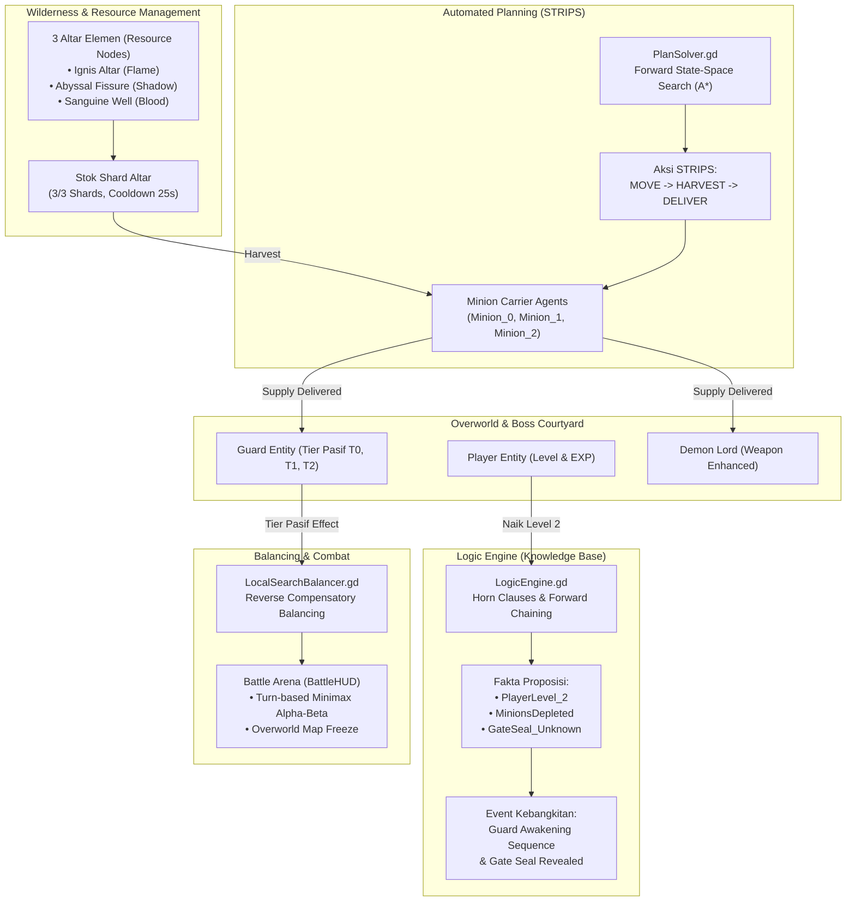

# 📜 DOKUMEN PENJELASAN IMPLEMENTASI TAHAP 4
## LOGIC & AUTOMATED PLANNING — INFERNAL AFFAIRS

---

## 📌 1. Pendahuluan & Latar Belakang

Dokumen ini menyajikan penjelasan komprehensif mengenai perancangan dan implementasi **Tahap 4 (Logic & Automated Planning)** pada game **Infernal Affairs** (dikembangkan menggunakan **Godot Engine 4.x**).

Tahap 4 melengkapi modul kecerdasan buatan sebelumnya:
* **Tahap 1:** *Pathfinding* (A* Search & Uniform Cost Search / Dijkstra)
* **Tahap 2:** *Constraint Satisfaction Problem* (CSP Backtracking dengan AC-3 & MRV Heuristics)
* **Tahap 3:** *Adversarial Search* (Minimax dengan Alpha-Beta Pruning) & *Local Search* (Hill Climbing / Simulated Annealing Balancer)
* **Tahap 4:** **Automated Planning (STRIPS / Classical Planning)** dan **Propositional Logic & Knowledge Base (Horn Clauses & Forward Chaining)**.

### Tujuan Utama Tahap 4:
1. **Automated Planning:** Memberikan kecerdasan berbasis perencanaan aksi klasik (*Classical STRIPS Planning*) kepada minion musuh agar dapat merumuskan rangkaian aksi (*plan*) pengumpulan sumber daya secara mandiri dari altar menuju Penjaga Gerbang (*Guard*) maupun Bos Neraka (*Demon Lord*).
2. **Propositional Logic & Knowledge Base:** Membangun *Knowledge Base* (KB) formal dengan penalaran *Horn Clauses* dan *Forward Chaining* untuk mengelola status segel misterius (*Gate Seal*), mendeteksi kebangkitan penjaga (*Guard Awakening*), serta merespons sabotase suplai oleh pemain.
3. **Adaptive Reverse Balancing:** Menghubungkan suplai elemen ke *Tier Pasif* Penjaga/Bos, yang kemudian diintegrasikan ke *Local Search Balancer* untuk menghasilkan kompensasi atribut fisik secara dinamis.
4. **Overworld State Synchronization:** Menjamin pengalaman bermain yang koheren melalui pembekuan peta (*overworld freeze*) saat pertempuran dan pembubaran minion (*minion dismissal*) saat Penjaga dikalahkan.

---

## 🏗️ 2. Arsitektur Sistem Terintegrasi

Hubungan antar modul kecerdasan buatan pada Tahap 4 digambarkan dalam diagram alir berikut:



---

## 🤖 3. Modul 1: Automated Planning (STRIPS / Classical Planning)

### 3.1. File Sumber
* [`scripts/core/PlanSolver.gd`](file:///c:/Users/richi/OneDrive/ドキュメント/GitHub/infernal-affairs/scripts/core/PlanSolver.gd)
* [`scripts/entities/Minion.gd`](file:///c:/Users/richi/OneDrive/ドキュメント/GitHub/infernal-affairs/scripts/entities/Minion.gd)

### 3.2. Landasan Teori STRIPS
**STRIPS** (*Stanford Research Institute Problem Solver*) merepresentasikan keadaan dunia (*world state*) sebagai himpunan predikat/fluents berlogika proposisional. Aksi didefinisikan menggunakan tiga komponen:
1. **Preconditions ($P$):** Syarat keadaan yang wajib terpenuhi sebelum aksi dapat dieksekusi.
2. **Add List ($A$):** Fakta baru yang menjadi benar setelah aksi selesai.
3. **Delete List ($D$):** Fakta yang tidak lagi berlaku setelah aksi selesai.

### 3.3. Skema Aksi STRIPS pada Game
| Aksi (*Action*) | Parameter | Preconditions ($P$) | Add List ($A$) | Delete List ($D$) |
| :--- | :--- | :--- | :--- | :--- |
| `MOVE(from, to)` | `from: Vector2i, to: Vector2i` | `At(minion, from)` | `At(minion, to)` | `At(minion, from)` |
| `HARVEST(altar, elem)` | `altar: Vector2i, elem: String` | `At(minion, altar) ∧ AltarHas(elem) ∧ Carrying(None)` | `Carrying(elem)` | `Carrying(None), AltarHas(elem)` |
| `DELIVER_GUARD(elem)` | `target: Vector2i, elem: String` | `At(minion, target) ∧ Carrying(elem)` | `GuardPowered(elem), Carrying(None)` | `Carrying(elem)` |
| `DELIVER_BOSS(elem)` | `target: Vector2i, elem: String` | `At(minion, target) ∧ Carrying(elem)` | `BossPowered(elem), Carrying(None)` | `Carrying(elem)` |

### 3.4. Algoritma Pencarian Rencana (*Plan Graph Search*)
`PlanSolver.gd` mengimplementasikan **Forward State-Space Search** berbasis algoritma $A^*$ untuk menemukan urutan aksi terpendek dari *Initial State* ke *Goal State*:
$$\text{Cost}(n) = f(n) = g(n) + h(n)$$
* $g(n)$: Jumlah langkah aksi yang telah dieksekusi dari state awal.
* $h(n)$: Estimasi jarak heuristik Manhattan ($\Delta x + \Delta y$) dari lokasi minion ke target berikutnya (lokasi altar jika belum membawa shard, atau lokasi Penjaga/Bos jika sudah membawa shard).

### 3.5. Alur Eksekusi pada Minion
1. Tiga minion pertama dikonfigurasi sebagai **Autonomous Carrier Agents**.
2. Minion memanggil `request_new_plan()` yang menghasilkan array langkah aksi:
   ```gdscript
   [
       {"type": ActionType.MOVE, "target_pos": Vector2i(8, 38)},
       {"type": ActionType.HARVEST, "element": "Flame"},
       {"type": ActionType.MOVE, "target_pos": Vector2i(21, 19)},
       {"type": ActionType.DELIVER_GUARD, "element": "Flame", "target_entity": "Guard"}
   ]
   ```
3. Minion mengeksekusi aksi satu per satu menggunakan algoritma pathfinding aktif (A* atau UCS). Begitu suplai terkirim, minion meminta rencana baru (*re-planning*) secara berkala.

---

## 🧠 4. Modul 2: Logic & Knowledge Base (Horn Clauses & Forward Chaining)

### 4.1. File Sumber
* [`scripts/core/LogicEngine.gd`](file:///c:/Users/richi/OneDrive/ドキュメント/GitHub/infernal-affairs/scripts/core/LogicEngine.gd)
* [`scripts/entities/Guard.gd`](file:///c:/Users/richi/OneDrive/ドキュメント/GitHub/infernal-affairs/scripts/entities/Guard.gd)
* [`scripts/UI/AwakeningBannerModal.gd`](file:///c:/Users/richi/OneDrive/ドキュメント/GitHub/infernal-affairs/scripts/UI/AwakeningBannerModal.gd)

### 4.2. Landasan Teori Forward Chaining
**Horn Clause** adalah bentuk klausa logika yang memiliki maksimal satu literal positif:
$$P_1 \land P_2 \land \dots \land P_k \implies Q$$
Algoritma **Forward Chaining** bersifat *data-driven*: dimulai dari fakta awal (*known facts*) yang ada di dalam Knowledge Base (KB), inferensi memeriksa klausa-klausa yang premisnya telah terpenuhi, kemudian menambahkan kesimpulan ($Q$) ke dalam KB hingga *goal query* tercapai atau tidak ada fakta baru yang dapat ditarik.

### 4.3. Basis Pengetahuan (Knowledge Base) Game
#### Himpunan Fakta (*Facts*):
* `PlayerLevel_1`, `PlayerLevel_2`, `PlayerLevel_3`
* `GateSeal_Unknown`, `GateSeal_Revealed`
* `GuardDormant`, `GuardAwakened`
* `MinionsActive`, `MinionsDepleted`
* `MinionSabotaged_Flame`, `MinionSabotaged_Shadow`, `MinionSabotaged_Blood`

#### Aturan Horn Clauses Utama:
1. **Rule 1 (Pencapaian Level Pemain):**
   $$\text{PlayerLevel\_2} \land \text{GuardDormant} \implies \text{GuardAwakened}$$
2. **Rule 2 (Pengungkapan Segel Gerbang):**
   $$\text{GuardAwakened} \land \text{GateSeal\_Unknown} \implies \text{GateSeal\_Revealed}$$
3. **Rule 3 (Sabotase Minion Alternatif):**
   $$\text{MinionsDepleted} \land \text{GuardDormant} \implies \text{GuardAwakened}$$
4. **Rule 4 (Kelemahan Taktis Penjaga):**
   $$\text{GateSeal\_Revealed} \land \text{SealOfFlame} \implies \text{VulnerableToShadow}$$
   $$\text{GateSeal\_Revealed} \land \text{SealOfShadow} \implies \text{VulnerableToBlood}$$
   $$\text{GateSeal\_Revealed} \land \text{SealOfBlood} \implies \text{VulnerableToFlame}$$

### 4.4. Sekuens Dramatis "Guard Awakening"
Ketika `LogicEngine` mendeduksi bahwa `GuardAwakened` dan `GateSeal_Revealed` bernilai `true` (saat pemain mencapai Level 2):
1. **Camera Shake & SFX:** Efek gempa layar kamera ($0.6$ detik, intensitas $6.0$) dan suara sirene bahaya.
2. **Monolog Penjaga:** Penjaga membuka mata dan berseru:
   > *"I HAVE AWAKENED! Segel Gerbang Istana telah aktif sepenuhnya! Hadapi kekuatan terbesarku!"*
3. **Banner Modal Popup:** Muncul jendela popup [`AwakeningBannerModal.gd`](file:///c:/Users/richi/OneDrive/ドキュメント/GitHub/infernal-affairs/scripts/UI/AwakeningBannerModal.gd) yang membekukan peta sementara untuk memberi pemain kesempatan membaca informasi taktis.
4. **Pengungkapan Segel di Overworld:** Tulisan segel di gerbang berubah dari `[✦ SEGEL MISTERIUS ✦]` menjadi identitas segel CSP yang sesungguhnya (misal: `[✦ SEAL OF FLAME ✦]`) dengan pendaran cahaya magis sesuai elemennya.

---

## 💎 5. Modul 3: Manajemen Altar & Shard (Resource Nodes)

### 5.1. File Sumber
* [`scripts/entities/ResourceNode.gd`](file:///c:/Users/richi/OneDrive/ドキュメント/GitHub/infernal-affairs/scripts/entities/ResourceNode.gd)

### 5.2. Spesifikasi 3 Altar di Wilderness
| Nama Altar | Elemen | Posisi Grid | Kapasitas Stok | Waktu Replenish | Warna Visual |
| :--- | :--- | :--- | :--- | :--- | :--- |
| **Ignis Altar** | Flame | `(8, 38)` | 3 Shards | 25 detik | Jingga Menyala (Orange) |
| **Abyssal Fissure** | Shadow | `(35, 38)` | 3 Shards | 25 detik | Ungu Kehampaan (Purple) |
| **Sanguine Well** | Blood | `(21, 32)` | 3 Shards | 25 detik | Merah Darah (Crimson) |

### 5.3. Siklus Pemanenan & Sinkronisasi Visual
1. **Pengurangan Stok Real-Time:** Setiap kali minion tiba di altar dan menjalankan aksi `HARVEST`, metode `harvest_shard()` dipanggil:
   * Stok $3/3$ berkurang menjadi $2/3$, lalu $1/3$, hingga $0/3$.
   * Sprite kristal altar berkedip kilau putih transparan.
   * Label di atas altar langsung diperbarui: `[✦ 2/3 Shards]`.
   * Jika stok habis, label berubah menjadi `[⚠ 0/3 Kosong]` dengan warna abu-abu.
2. **Pengisian Ulang (Replenishment Timer):** Jika stok kurang dari kapasitas maksimal ($< 3$), timer internal berdetik setiap frame. Setiap 25 detik, 1 shard baru terisi kembali secara otomatis hingga penuh ($3/3$).
3. **Pencegahan Eksploitasi Altar Kosong:** Jika altar berada pada kondisi $0/3$, pemanggilan `harvest_shard()` mengembalikan nilai `false`. Minion tidak akan mendapatkan shard palsu, melainkan membatalkan aksi dan meminta perencanaan ulang (*re-planning*).

---

## ⚖️ 6. Modul 4: Integrasi Penyeimbangan Adaptif (Local Search Balancer)

### 6.1. File Sumber
* [`scripts/core/LocalSearchBalancer.gd`](file:///c:/Users/richi/OneDrive/ドキュメント/GitHub/infernal-affairs/scripts/core/LocalSearchBalancer.gd)
* [`scripts/UI/PreBattleLoadingOverlay.gd`](file:///c:/Users/richi/OneDrive/ドキュメント/GitHub/infernal-affairs/scripts/UI/PreBattleLoadingOverlay.gd)

### 6.2. Konsep Reverse Compensatory Balancing
Pada game RPG konvensional, musuh yang mendapatkan pasif kuat akan menjadi jauh lebih sulit, sedangkan musuh dengan pasif lemah menjadi terlalu mudah dikalahkan. Pada Tubes ini, kita menerapkan **Penyeimbangan Terbalik (Reverse Compensatory Balancing)** menggunakan algoritma *Local Search*:

$$\text{Power}_{\text{NPC}} = \text{Atribut Fisik} + P_{\text{passive}}$$

| Tier Pasif | Keterangan Status Suplai | Nilai Pengali $P_{\text{passive}}$ | Respons Local Search Balancer |
| :--- | :--- | :--- | :--- |
| **Tier 0 (Weakened)** | Tidak menerima suplai / minion disabotase | $-25$ Poin | Atribut fisik (HP, ATK, Def, Potion) **dinaikkan** agar musuh tetap menantang. |
| **Tier 1 (Standard)** | Suplai normal seimbang | $0$ Poin | Atribut fisik berada pada nilai **standar/baseline**. |
| **Tier 2 (Overcharged)** | Menerima suplai penuh dari minion | $+35$ Poin | Atribut fisik (HP, ATK, Def) **dikurangi secara proporsional** agar pertarungan tetap adil. |

### 6.3. Fungsi Evaluasi Fitness
Algoritma Local Search mencari konfigurasi keadaan atribut $s$ yang meminimalkan deviasi terhadap target kelayakan $F_{\text{target}}$:
$$\text{Fitness}(s) = - \left| \text{Power}_{\text{NPC}}(s) - F_{\text{target}} \right|$$
Proses optimasi disimulasikan secara visual dengan grafik interaktif di modal [`PreBattleLoadingOverlay.gd`](file:///c:/Users/richi/OneDrive/ドキュメント/GitHub/infernal-affairs/scripts/UI/PreBattleLoadingOverlay.gd) sebelum pertarungan turn-based dimulai.

---

## ❄️ 7. Modul 5: Overworld Map Freeze & UX Flow

### 7.1. Mekanisme Map Freeze
Agar dunia game terasa tertata dan terfokus saat pertarungan, game menghentikan seluruh aktivitas di overworld melalui fungsi `_freeze_overworld_map(freeze: bool)` di [`Main.gd`](file:///c:/Users/richi/OneDrive/ドキュメント/GitHub/infernal-affairs/scripts/Main.gd):
1. **Scene Tree Paused:** Memanggil `get_tree().paused = freeze`.
2. **Entity Activity Flag:** Mengubah `is_active = not freeze` pada seluruh minion yang masih hidup, Penjaga, Bos, dan pemain.
3. **Pengecualian Process Mode:** Node antarmuka dan pertempuran dikonfigurasi dengan `process_mode = Node.PROCESS_MODE_ALWAYS` agar tetap berjalan lancar saat map dijeda:
   * `BattleManager.gd` (menghitung AI Minimax & timer giliran)
   * `BattleHUD.gd` (menerima klik tombol & memainkan animasi duel)
   * `PreBattleBriefingModal.gd` & `PreBattleLoadingOverlay.gd`
   * `AwakeningBannerModal.gd`

### 7.2. Pembubaran Minion (*Minion Dismissal*)
Ketika pemain berhasil menaklukkan Penjaga Gerbang (*Hell Guard*):
1. Kunci Istana (*Castle Key*) diberikan kepada pemain dan gerbang terbuka.
2. Penjaga memancarkan animasi kekalahan dan menghilang.
3. Fungsi `_dismiss_all_minions()` dipanggil: seluruh minion yang sedang berpatroli maupun membawa suplai shard akan memudar (*fade out*) perlahan lalu dihapus dari memori (*queue_free*). Dunia wilderness menjadi aman bagi pemain untuk masuk ke ruang tahta Bos Neraka.

---

## 🧪 8. Panduan Pengujian & Verifikasi Fitur

Berikut adalah langkah-langkah untuk memverifikasi fitur Tahap 4 di dalam game:

### 8.1. Pintasan Tombol Debug (Keyboard Shortcuts)
| Tombol | Fungsi |
| :---: | :--- |
| `L` atau `C` | Cheat **Level Up** (+1 Level instan untuk pemain). |
| `K` | Mengaktifkan/menonaktifkan auto-level sesuai syarat gerbang. |
| `TAB` | Mengganti algoritma pathfinding antara **A\*** (Heuristik) dan **UCS** (Dijkstra). |
| `P` atau `ESC` | Membuka modal ringkasan briefing konsep AI dan menjeda game. |
| `F3` | Menampilkan overlay HUD debug performa dan status AI. |
| `R` | Me-restart permainan dari awal. |

### 8.2. Skenario Pengujian Lapangan
1. **Uji Pengurangan Stok Shard Altar:**
   * Dekati salah satu altar (misal *Ignis Altar* di kiri bawah).
   * Amati minion kurir yang datang: saat minion mendekati altar, angka stok akan berkurang dari `[✦ 3/3 Shards]` menjadi `[✦ 2/3 Shards]`, dan minion akan memunculkan kristal api di atas kepalanya.
   * Amati notifikasi floating alert: *"Minion memanen Shard Flame dari Ignis Altar! [Tersisa: 2/3]"*.
2. **Uji Sabotase Minion oleh Pemain:**
   * Dekati minion yang sedang membawa shard kristal di kepalanya.
   * Masuki pertempuran dan kalahkan minion tersebut.
   * Muncul notifikasi sabotase: *"Minion dijatuhkan! Esensi Flame berhasil disabotase."*
   * Penjaga Gerbang tidak akan menerima suplai tersebut sehingga pasifnya tetap pada Tier 0 (Weakened).
3. **Uji Kebangkitan Penjaga (Level 2 Trigger):**
   * Naikkan level pemain menjadi Level 2 (bisa dengan mengalahkan 2 minion liar atau menekan tombol cheat `L`).
   * Layar kamera akan bergetar (*camera shake*), sirene berbunyi, dan jendela dialog modal *"I HAVE AWAKENED!"* muncul.
   * Di atas gerbang, segel yang sebelumnya misterius kini menampilkan nama segel CSP yang sebenarnya.
4. **Uji Map Freeze saat Pertempuran:**
   * Dekati minion liar mana pun untuk memicu pertempuran.
   * Perhatikan bahwa latar belakang map, minion lain di kejauhan, dan animasi kristal langsung membeku total (*freeze*).
   * Begitu duel selesai (menang atau kabur dengan ESC), map kembali aktif normal (*unfreeze*).
5. **Uji Mundurnya Minion saat Penjaga Kalah:**
   * Tantang Penjaga Gerbang di halaman gerbang tengah.
   * Menangkan pertarungan turn-based melawannya.
   * Begitu kembali ke overworld, seluruh minion kurir di area wilderness akan otomatis mundur dan menghilang (*dismissed*).

---

## 📁 9. Struktur Berkas yang Terlibat di Tahap 4

```text
infernal-affairs/
├── scripts/
│   ├── core/
│   │   ├── PlanSolver.gd             # Classical STRIPS Planning (A* Plan Search)
│   │   ├── LogicEngine.gd            # Propositional Logic KB (Horn Clauses & Forward Chaining)
│   │   └── LocalSearchBalancer.gd    # Reverse Compensatory Balancing
│   ├── entities/
│   │   ├── ResourceNode.gd           # Elemental Altars & Shard Tracking (3/3, Cooldown)
│   │   ├── Minion.gd                 # Carrier Plan Execution & Shard Indicator
│   │   └── Guard.gd                  # Awakening State, Passive Tiers, & Dynamic Visuals
│   ├── UI/
│   │   ├── AwakeningBannerModal.gd   # Dialog Kebangkitan Penjaga (Level 2 Modal)
│   │   ├── PreBattleBriefingModal.gd # Briefing Intel Segel (Unrevealed vs Revealed)
│   │   └── PreBattleLoadingOverlay.gd# Visualisasi Algoritma Local Search Balancer
│   ├── battle/
│   │   ├── BattleManager.gd          # Orkestrasi Pertarungan (Process Mode Always)
│   │   └── BattleHUD.gd              # Antarmuka Duel Turn-Based (Process Mode Always)
│   └── Main.gd                       # Pengendali Utama Overworld, Freeze Map, & Event Wiring
├── PENJELASAN_IMPLEMENTASI_TAHAP_4.md # Dokumen penjelasan implementasi Tahap 4 ini
└── README.md                         # Dokumentasi utama proyek Infernal Affairs
```

---

*Dokumen ini disusun sebagai panduan teknis resmi implementasi Tahap 4 dalam rangka penyelesaian Tugas Besar Mata Kuliah Kecerdasan Buatan.*

