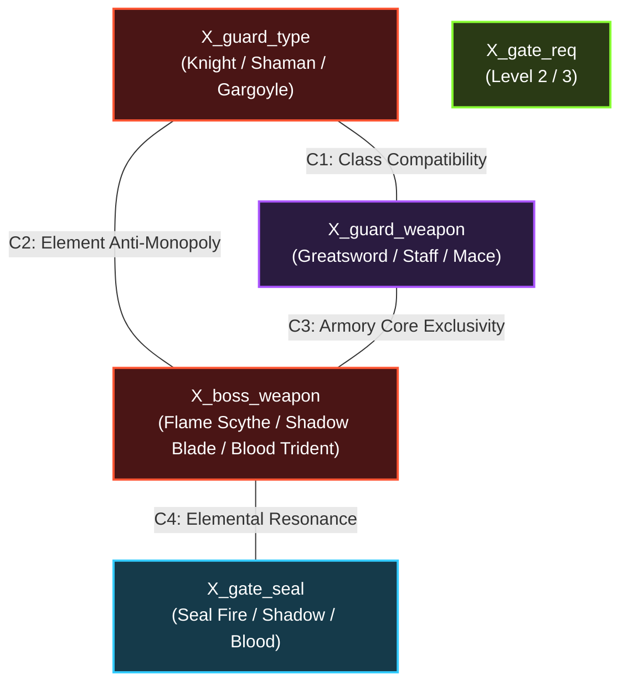

# RANCANGAN IMPLEMENTASI TUBES TAHAP 3: INFERNAL AFFAIRS
## Hybrid AI System: Constraint Satisfaction Problem (CSP) & Local Search Dynamic Balancer

Dokumen ini merangkum seluruh perencanaan arsitektur, formulasi algoritma AI (CSP & Local Search), alur gameplay terintegrasi, desain *Pre-Battle Loading Debug Overlay*, serta daftar aset visual dan audio tambahan yang dibutuhkan untuk menyelesaikan **Tubes Tahap 3 (Kecerdasan Buatan)**.

---

## 1. Ringkasan Visi & Alur Gameplay Terintegrasi

Tubes Tahap 3 mengombinasikan seluruh capaian dari tahap sebelumnya menjadi satu ekosistem game RPG taktis neraka yang utuh:
* **Tahap 1 (Pathfinding - A*):** Digunakan untuk pergerakan NPC di map labirin dan pengejaran patroli.
* **Tahap 2 (Adversarial Search - Minimax with Alpha-Beta):** Digunakan saat masuk ke arena turn-based duel.
* **Tahap 3 (Konfigurasi Optimal - CSP & Local Search):** Digunakan sebagai **AI Sutradara (*Encounter Director*)** yang mengatur komposisi formasi benteng (CSP) dan mengoptimasi stat/loadout musuh secara dinamis (Local Search) sebelum duel dimulai agar pertarungan seimbang (*tidak terlalu gampang, tidak terlalu sulit*).

```
[SPAWN PLAYER] 
  (Level 1, 100 HP, 1 Potion, Basic Stats)
         │
         ▼
[FASE 1: GRINDING & LOOTING]
  - Minion berkeliaran dengan jalan lambat (A*).
  - Player duel turn-based dengan Minion (Minimax Depth 1-2).
  - Menang duel -> Naik ke Level 2 + Loot Potion & EXP.
         │
         ▼
[FASE 2: GERBANG PENJAGA ISTANA]
  - Menuju gerbang istana (Ada Unary Constraint CSP: Syarat Min. Level 2).
  - Konfigurasi Penjaga ditentukan oleh CSP Solver (Tipe, Senjata, Segel Gerbang).
  - [PRE-BATTLE LOADING OVERLAY AKTIF]:
    Local Search (Hill Climbing / Simulated Annealing) membaca stat Player
    dan mengoptimasi konfigurasi Penjaga (HP, Atk, Def, Item, Minimax Depth).
  - Kalahkan Penjaga -> Drop "Castle Key" + Naik ke Level 3.
         │
         ▼
[FASE 3: RUANG TAHTA BOS ISTANA]
  - Menggunakan Castle Key untuk membuka pintu tahta Bos Neraka.
  - Senjata Bos ditentukan oleh relasi CSP (Anti-Monopoly & Resonansi Segel).
  - [PRE-BATTLE LOADING OVERLAY AKTIF]:
    Local Search mengoptimasi loadout Bos (HP tebal, Heavy Damage, Potion, Depth 3-4).
  - Duel final klimaks melawan Bos Neraka.
  - Bos kalah -> [VICTORY SCREEN] Penaklukan Istana Neraka Sukses!
```

---

## 2. Formulasi CSP (Constraint Satisfaction Problem)

Sesuai materi kuliah Modul 6, CSP menentukan **aturan penugasan benteng (*Castle Defense Assignment*)** sebelum musuh di-spawn. CSP menjamin solusi bersifat **Complete** dan **Consistent**.

Untuk mendemonstrasikan graf kekangan yang kaya (*non-trivial constraint network*), CSP ini menggunakan **5 Variabel Utama** dengan **4 Binary Constraints yang saling mengunci (*cyclic/interconnected*)**, sehingga inferensi pemangkasan domain **AC-3 (Arc Consistency)** dan heuristik **MRV / LCV** dapat diuji dan dipamerkan secara nyata kepada dosen penguji.

### 2.1 Komponen Triplet $\langle X, D, C \rangle$

#### A. Variabel ($X$)
1. $X_{\text{guard\_type}}$: Tipe/Archetype karakter Penjaga Gerbang.
2. $X_{\text{guard\_weapon}}$: Tipe senjata yang digunakan Penjaga Gerbang.
3. $X_{\text{boss\_weapon}}$: Senjata utama Bos Neraka di Ruang Tahta.
4. $X_{\text{gate\_seal}}$: Jenis segel magis penghalang yang terpasang pada Gerbang Besi Neraka.
5. $X_{\text{gate\_req}}$: Syarat level minimal player untuk menantang Penjaga Gerbang.
6. $X_{\text{castle\_potions}}$: Kuota total potion logistik istana neraka.

#### B. Domain ($D$)
1. $D(X_{\text{guard\_type}}) = \{\text{Infernal Knight (Fisik)}, \text{Abyssal Shaman (Sihir)}, \text{Obsidian Gargoyle (Tank)}\}$
2. $D(X_{\text{guard\_weapon}}) = \{\text{Flame Greatsword}, \text{Void Staff}, \text{Chaos Mace}\}$
3. $D(X_{\text{boss\_weapon}}) = \{\text{Flame Scythe}, \text{Shadow Blade}, \text{Blood Trident}\}$
4. $D(X_{\text{gate\_seal}}) = \{\text{Seal of Fire}, \text{Seal of Shadow}, \text{Seal of Blood}\}$
5. $D(X_{\text{gate\_req}}) = \{2, 3\}$
6. $D(X_{\text{castle\_potions}}) = \{2, 3, 4\}$

#### C. Batasan / Constraints ($C$)

##### 1. Unary Constraints (Satu Variabel)
* **Kekangan Masuk Gerbang:** Syarat gerbang tidak boleh mengizinkan player Level 1 langsung masuk:
  $$X_{\text{gate\_req}} \ge 2$$
* **Kelayakan Persenjataan:** Senjata Bos tidak boleh berstatus kosong/unequipped:
  $$X_{\text{boss\_weapon}} \neq \text{None}$$

##### 2. Binary Constraints (Relasi Antar Dua Variabel)
1. **Constraint 1 (Class Compatibility: $X_{\text{guard\_type}} \leftrightarrow X_{\text{guard\_weapon}}$):**
   Penjaga hanya boleh memegang senjata yang kompatibel dengan profisiensi kelasnya:
   * *Infernal Knight (Fisik)* $\in \{\text{Flame Greatsword}, \text{Chaos Mace}\}$ *(tidak boleh memakai Void Staff)*.
   * *Abyssal Shaman (Sihir)* $\in \{\text{Void Staff}, \text{Flame Greatsword}\}$ *(tidak boleh memakai Chaos Mace berat)*.
   * *Obsidian Gargoyle (Tank)* $\in \{\text{Chaos Mace}, \text{Void Staff}\}$ *(tidak boleh memakai Flame Greatsword)*.
   $$\text{Compatible}(X_{\text{guard\_type}}, X_{\text{guard\_weapon}}) = \text{True}$$

2. **Constraint 2 (Element Anti-Monopoly: $X_{\text{guard\_type}} \leftrightarrow X_{\text{boss\_weapon}}$):**
   Elemen dasar pertahanan Penjaga tidak boleh sama dengan senjata Bos agar Player dituntut mengganti strategi elemen saat beralih dari fase Penjaga ke fase Bos:
   $$\text{Element}(X_{\text{guard\_type}}) \neq \text{Element}(X_{\text{boss\_weapon}})$$
   * Jika *Infernal Knight (Api)* $\implies X_{\text{boss\_weapon}} \neq \text{Flame Scythe}$.
   * Jika *Abyssal Shaman (Shadow)* $\implies X_{\text{boss\_weapon}} \neq \text{Shadow Blade}$.
   * Jika *Obsidian Gargoyle (Blood/Earth)* $\implies X_{\text{boss\_weapon}} \neq \text{Blood Trident}$.

3. **Constraint 3 (Armory Core Exclusivity: $X_{\text{guard\_weapon}} \leftrightarrow X_{\text{boss\_weapon}}$):**
   Gudang persenjataan benteng neraka memiliki stok material inti terbatas; Penjaga dan Bos tidak boleh memakai senjata berbahan inti magis yang sama di satu sesi pertempuran:
   $$\text{CoreMaterial}(X_{\text{guard\_weapon}}) \neq \text{CoreMaterial}(X_{\text{boss\_weapon}})$$
   * *Flame Greatsword (Core Api)* $\implies X_{\text{boss\_weapon}} \neq \text{Flame Scythe}$.
   * *Void Staff (Core Shadow)* $\implies X_{\text{boss\_weapon}} \neq \text{Shadow Blade}$.
   * *Chaos Mace (Core Darah)* $\implies X_{\text{boss\_weapon}} \neq \text{Blood Trident}$.

4. **Constraint 4 (Elemental Resonance: $X_{\text{boss\_weapon}} \leftrightarrow X_{\text{gate\_seal}}$):**
   Segel magis pada gerbang istana ditenagai oleh resonansi aura dari senjata Bos di ruang tahta:
   $$\text{Resonates}(X_{\text{boss\_weapon}}, X_{\text{gate\_seal}}) = \text{True}$$
   * *Flame Scythe* $\iff$ *Seal of Fire*.
   * *Shadow Blade* $\iff$ *Seal of Shadow*.
   * *Blood Trident* $\iff$ *Seal of Blood*.

##### 3. Global Constraint (Multi Variabel)
* **Alokasi Potion Istana:** Jumlah total potion yang dibawa Penjaga dan Bos tidak boleh melebihi pasokan logistik istana:
  $$\text{Potion}_{\text{Guard}} + \text{Potion}_{\text{Boss}} \le X_{\text{castle\_potions}}$$

### 2.2 Diagram Graf Kekangan (Constraint Graph)



> **Dampak Akademis Arc Consistency (AC-3):**  
> Graf di atas memiliki siklus segitiga antara $X_{\text{guard\_type}}$, $X_{\text{guard\_weapon}}$, dan $X_{\text{boss\_weapon}}$. Ketika Backtracking memilih suatu nilai untuk $X_{\text{guard\_type}}$, algoritma AC-3 secara otomatis memangkas domain $X_{\text{guard\_weapon}}$, yang kemudian memicu pemangkasan domain $X_{\text{boss\_weapon}}$, lalu membatasi pilihan $X_{\text{gate\_seal}}$. Hal ini membuktikan algoritma CSP bekerja aktif dan terukur.

---

### 2.3 Strategi Visualisasi 9 Variasi Karakter (Pendekatan Modular - Opsi A)

Untuk merepresentasikan 9 kemungkinan kombinasi Penjaga ($3 \text{ Guard Types} \times 3 \text{ Weapons}$) secara visual tanpa harus menggambar 9 spritesheet animasi raksasa dari nol, game menerapkan sistem **Modular Visuals**:

1. **3 Base Spritesheet Karakter Unik (Overworld & Battle):**
   * **Infernal Knight:** Tubuh zirah plate hitam obsidian tegap, helm tanduk api, animasi sabetan pedang.
   * **Abyssal Shaman:** Jubah bertudung ungu-hitam compang-camping, mengambang, animasi membaca mantra sihir.
   * **Obsidian Gargoyle:** Monster batu berkepak sayap, siluet bungkuk berotot, animasi hantaman tanah.
2. **3 Senjata / Aura Terpasang Dinamis:**
   * Node `Sprite2D` senjata dipasangkan (*attached*) ke bone/hand slot karakter, memancarkan efek partikel sesuai senjata terpilih (*Flame Greatsword*, *Void Staff*, atau *Chaos Mace*).
3. **9 Avatar Portrait Khusus untuk HUD Duel:**
   * Setiap kombinasi Guard Type + Weapon memiliki icon avatar portrait tersendiri pada HUD duel (contoh: *Knight with Greatsword*, *Knight with Mace*, *Shaman with Staff*, dst.).
4. **3 Efek Visual Serangan (Attack VFX Spritesheet):**
   * *Flame Slash VFX:* Sabetan pedang api melengkung membara.
   * *Void Orb VFX:* Bola proyektil sihir hitam-ungu meledak.
   * *Earth Bash VFX:* Hantaman gada batu retakan tanah berpendar.

---

## 3. Formulasi Local Search & Optimization (Dynamic Balancer)

Setelah CSP menentukan kerangka legal benteng, algoritma Local Search dipanggil tepat sebelum duel (pada fase loading transition) untuk menemukan **titik keseimbangan optimal** (*difficulty curve*).

### 3.1 State Representation (Vektor Konfigurasi Musuh)
Satu konfigurasi musuh sebelum bertarung direpresentasikan sebagai vektor parameter berukuran memori $O(1)$:
$$S = [HP, Atk, HeavyAtk, Def, PotionCount, PotionHeal, MinimaxDepth]$$

*Rentang Nilai Variabel:*
* $HP \in [60, 250]$
* $Atk \in [8, 30]$
* $HeavyAtk \in [16, 50]$
* $Def \in [2, 12]$
* $PotionCount \in [0, 3]$
* $PotionHeal \in [20, 45]$
* $MinimaxDepth \in [1, 4]$

### 3.2 Neighbourhood Function (Langkah Tetangga / Successor)
State tetangga $S'$ diperoleh melalui 1 langkah perubahan lokal (perturbasi acak):
* $HP \leftarrow HP \pm 10$
* $Atk \leftarrow Atk \pm 2$
* $HeavyAtk \leftarrow HeavyAtk \pm 3$
* $Def \leftarrow Def \pm 1$
* $PotionCount \leftarrow PotionCount \pm 1$
* $MinimaxDepth \leftarrow MinimaxDepth \pm 1$
*(Dengan validasi clamping batas min-max).*

### 3.3 Objective / Fitness Function $f(S)$ (Formula Keseimbangan Game)
Target desain: **Win Rate Player $\approx 55\%$ (duel seru & adil) dan Durasi Duel $\approx 5 - 7$ Ronde.**

Nilai evaluasi dihitung berdasarkan gap kekuatan teoretis (*Combat Power Gap*) terhadap kondisi aktual Player:
$$\text{Power}_{\text{Player}} = HP_{\text{Player}} + (Atk_{\text{Player}} \times 2.5) + (Def_{\text{Player}} \times 3.0) + (Potion_{\text{Player}} \times 20)$$
$$\text{Power}_{\text{NPC}}(S) = HP + (Atk \times 2.2) + (HeavyAtk \times 1.2) + (Def \times 3.0) + (PotionCount \times PotionHeal \times 0.7) + (MinimaxDepth \times 15)$$

Fungsi objektif yang ingin **dimaksimalkan** (semakin mendekati 0 semakin sempurna):
$$f(S) = - \left( |\text{Power}_{\text{NPC}}(S) - (\text{Power}_{\text{Player}} \times \text{TargetRatio})| \right)$$
* Untuk Penjaga: $\text{TargetRatio} = 1.05$ (sedikit lebih kuat dari player).
* Untuk Bos: $\text{TargetRatio} = 1.25$ (bos menantang, membutuhkan taktik potion & defend yang matang).

### 3.4 Algoritma yang Disediakan & Dibandingkan
1. **Hill Climbing (Steepest-Ascent):** Selalu memilih tetangga terbaik. Jika tidak ada perbaikan, berhenti (mendeteksi *Local Maximum* / *Plateau*).
2. **Hill Climbing + Random Restart:** Mengulang pencarian dari seed acak baru jika buntu di *local optimum*.
3. **Simulated Annealing (SA):**
   * Suhu awal $T_0 = 100.0$, Cooling schedule $T \leftarrow T \times 0.95$, Ambang henti $\epsilon = 0.05$.
   * Jika $\Delta E = f(S') - f(S) > 0$, selalu terima state baru.
   * Jika $\Delta E \le 0$, terima langkah lebih buruk (*downhill*) dengan probabilitas:
     $$P = e^{\frac{\Delta E}{T}}$$
   * Mengizinkan eksplorasi keluar dari jurang (*ridge*) dan puncak palsu (*local optimum*).

---

## 4. Desain Pre-Battle Loading Debug Overlay

Untuk kebutuhan presentasi akademis, saat player menabrak/menantang Penjaga atau Bos, game menampilkan **Layar Transisi / Loading Screen Berisi Live Debug Overlay**:

### 4.1 Elemen Tampilan Loading Overlay
1. **Panel Player Profile (Kondisi Nyata):**
   * Menampilkan HP saat ini, Level, Jumlah Potion, dan Perkiraan Combat Power.
2. **Visualizer Proses Pencarian (Real-Time):**
   * Progress bar iterasi langkah ($t = 1 \dots 50$).
   * Teks log pergerakan state:
     * `[Step 04] Try: +1 Potion, -2 Atk -> Score: -24.5 -> ACCEPTED`
     * `[Step 07] Try: +1 Depth -> Score: -38.0 -> DOWNHILL ACCEPTED (P=0.62, T=45.2)` *(khusus SA)*
     * `[Step 15] No better neighbour -> STUCK AT LOCAL MAXIMUM` *(khusus HC)*
3. **Panel Hasil Konfigurasi Akhir:**
   * Kartu Stat Musuh sebelum vs sesudah dioptimasi:
     * HP Awal $\to$ HP Optimal
     * Minimax Depth Awal $\to$ Depth Optimal
     * Potion & Stat Damage Terpilih
4. **Kontrol Interaktif Presentasi:**
   * Tombol `[Lanjut ke Battle]` (atau countdown otomatis 2.5 detik).
   * Tombol `[Ganti Algoritma: HC vs SA]` untuk demo langsung di depan dosen.

---

## 5. Rincian Kebutuhan Aset Tambahan (Lengkap & Terstruktur)

### 5.1 Aset Visual: Karakter & NPC
| Nama Aset | Tipe | Deskripsi & Spesifikasi | Status |
| :--- | :--- | :--- | :--- |
| `minion_imp.png` | Spritesheet | Karakter imp merah kecil, bertanduk, animasi Idle & Walk 4-arah. | Selesai / Terintegrasi |
| `guard_knight.png` | Spritesheet | Base Guard Archetype 1: Ksatria zirah hitam berpedang api. | Selesai / Terintegrasi |
| `guard_shaman.png` | Spritesheet | Base Guard Archetype 2: Penyihir jubah bertudung ungu-hitam, melayang. | Siap Generate |
| `guard_gargoyle.png`| Spritesheet | Base Guard Archetype 3: Monster gargoyle batu bersayap kelabu. | Siap Generate |
| `demon_boss.png` | Spritesheet | Bos besar iblis penguasa tahta neraka bermahkota tanduk. | Selesai / Terintegrasi |

### 5.2 Aset Visual: Senjata Modular & VFX Serangan
| Nama Aset | Tipe | Deskripsi & Spesifikasi | Status |
| :--- | :--- | :--- | :--- |
| `weapon_flame_sword.png` | Sprite / Icon | Pedang besar api membara (*Flame Greatsword*). | Siap Generate |
| `weapon_void_staff.png` | Sprite / Icon | Tongkat kristal bayangan ungu bercahaya (*Void Staff*). | Siap Generate |
| `weapon_chaos_mace.png` | Sprite / Icon | Gada duri batu magma darah (*Chaos Mace*). | Siap Generate |
| `weapon_flame_scythe.png` | Sprite / Icon | Sabit raksasa api neraka milik Bos (*Flame Scythe*). | Siap Generate |
| `weapon_shadow_blade.png` | Sprite / Icon | Pedang bayangan obsidian terkutuk milik Bos (*Shadow Blade*). | Siap Generate |
| `weapon_blood_trident.png` | Sprite / Icon | Trisula darah magma bertanduk milik Bos (*Blood Trident*). | Siap Generate |
| `vfx_flame_slash.png` | VFX Spritesheet | Efek tebasan melengkung api membakar (4 frame horizontal). | Siap Generate |
| `vfx_void_orb.png` | VFX Spritesheet | Efek tembakan bola energi gelap & ledakan (4 frame). | Siap Generate |
| `vfx_earth_bash.png` | VFX Spritesheet | Efek retakan batu tanah magma saat dihantam (4 frame). | Siap Generate |

### 5.3 Aset Visual: UI, Emblem Segel & Avatar HUD
| Nama Aset | Tipe | Deskripsi & Spesifikasi | Status |
| :--- | :--- | :--- | :--- |
| `seal_fire.png` | UI Emblem | Emblem segel api gerbang neraka (Segel Merah). | Siap Generate |
| `seal_shadow.png` | UI Emblem | Emblem segel bayangan gerbang neraka (Segel Ungu). | Siap Generate |
| `seal_blood.png` | UI Emblem | Emblem segel darah gerbang neraka (Segel Crimson). | Siap Generate |
| `avatar_grid_9guards.png` | UI Portrait Sheet | Sheet grid 9 avatar portrait duel ($3 \times 3$) untuk tiap kombinasi Guard + Weapon. | Siap Generate |
| `icon_castle_key.png` | UI Icon | Kunci emas kuno berukir kepala iblis. | Selesai / Terintegrasi |
| `icon_level_badge.png` | UI Icon | Badge emblem level player (Level 1, 2, 3) di HUD. | Selesai / Terintegrasi |
| `panel_loading_bg.png` | UI Background | Latar kaca obsidian gelap transparan untuk layar transisi AI. | Selesai / Terintegrasi |
| `icon_algorithm_chip.png`| UI Icon | Ikon chip sirkuit / otak AI untuk indikator Local Search aktif. | Selesai / Terintegrasi |
| `icon_heavy_attack.png` | UI Icon | Ikon pedang menyala ganda untuk aksi Heavy Attack. | Selesai / Terintegrasi |

### 5.4 Aset Audio & Sound Effects (SFX)
| Nama Aset | Format | Deskripsi Suara | Status |
| :--- | :--- | :--- | :--- |
| `sfx_encounter_alert.wav` | SFX | Bunyi drum dentuman tegang saat menabrak penjaga / bos. | Selesai / Terintegrasi |
| `sfx_balancer_tick.wav` | SFX | Suara klik digital cepat saat Local Search menguji iterasi tetangga di loading overlay. | Selesai / Terintegrasi |
| `sfx_gate_unlock.wav` | SFX | Suara rantai berat putus dan gerbang batu bergeser terbuka. | Selesai / Terintegrasi |
| `sfx_level_up.wav` | SFX | Denting kemenangan fanfare pendek saat naik level. | Selesai / Terintegrasi |
| `bgm_boss_chamber.ogg` | BGM | Musik orkestra dramatis ritme cepat untuk pertarungan ruang tahta Bos. | Selesai / Terintegrasi |

---

## 6. Rencana Tahapan Eksekusi (Implementation Steps)

1. **Step 1 - Data Architecture & Player Stats:**
   * Tambahkan sistem `Level`, `Exp`, dan inventory `CastleKey` pada `PlayerData`.
   * Perluas `BattleState` agar mendukung parameter dinamis: `HeavyAttack`, `PotionCount`, `PotionHealValue`, dan `MinimaxDepth`.

2. **Step 2 - CSP Solver Module (`CSPSolver.gd`):**
   * Implementasikan struktur data $X, D, C$ dengan 5 Variabel & 4 Binary Constraints.
   * Tulis algoritma Backtracking dengan MRV, LCV, dan propagasi AC-3.
   * Uji coba pembangkitan konfigurasi benteng konsisten dan komplit saat game dimuat.

3. **Step 3 - Local Search Dynamic Balancer (`LocalSearchBalancer.gd`):**
   * Tulis fungsi penghitung Fitness/Objective $f(S)$.
   * Implementasikan Hill Climbing (dengan deteksi local maximum) dan Simulated Annealing (dengan parameter suhu $T$ dan cooling schedule).

4. **Step 4 - Pre-Battle Loading Screen & Debug Visualizer Scene:**
   * Buat scene transisi UI baru (`PreBattleLoadingScene.tscn`).
   * Hubungkan pemanggilan Local Search ke animasi visual step-by-step.
   * Tambahkan tombol toggle algoritma untuk demo dosen.

5. **Step 5 - Modular Guard & VFX Integration:**
   * Pasang sistem weapon slot modular pada Penjaga Gerbang berdasarkan hasil solusi CSP.
   * Pasang VFX serangan (Flame Slash, Void Orb, Earth Bash) pada aksi duel.

6. **Step 6 - Penulisan Laporan & Dokumentasi:**
   * Masukkan tabel komparasi matematis CSP (MRV vs tanpa MRV, iterasi AC-3) dan Local Search (Hill Climbing vs SA).
   * Dokumentasikan screenshot Pre-Battle Loading Screen dan visualisasi graf CSP sebagai bukti implementasi nyata.
